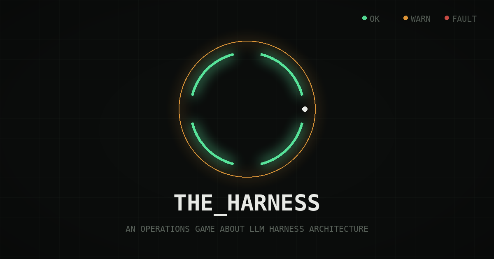
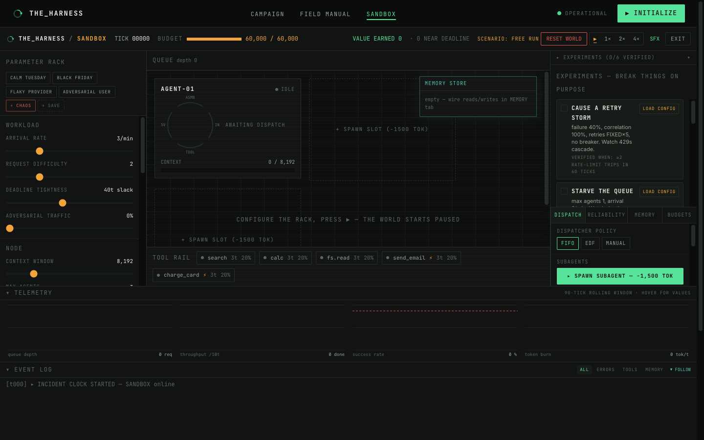
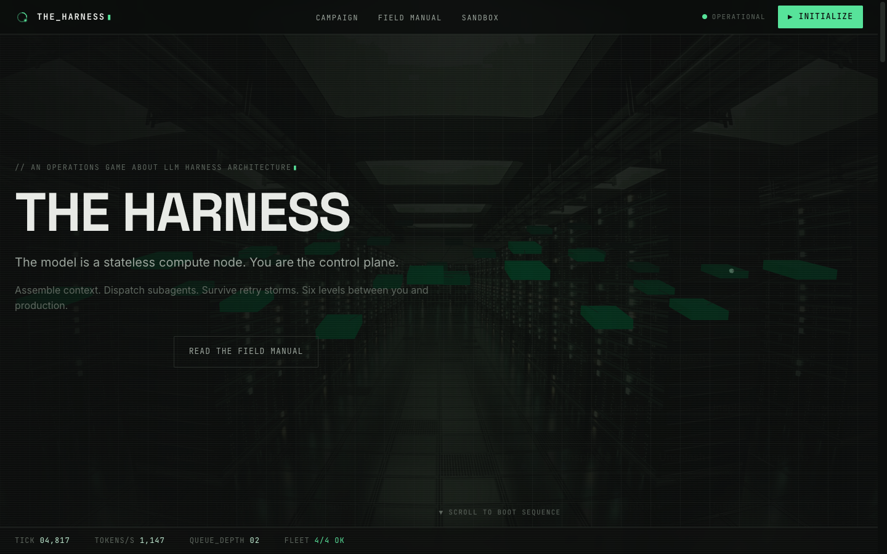
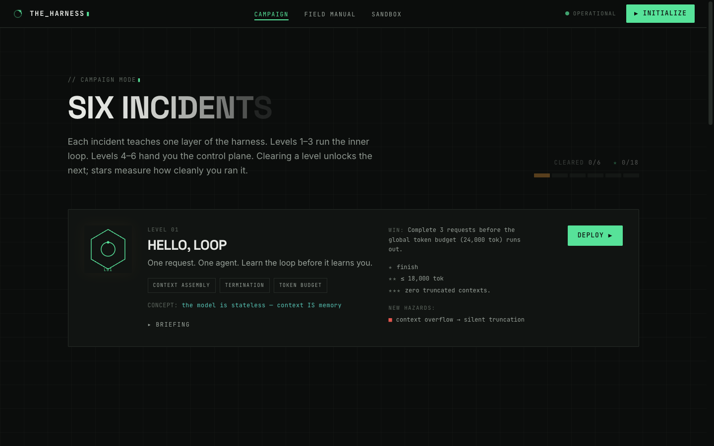
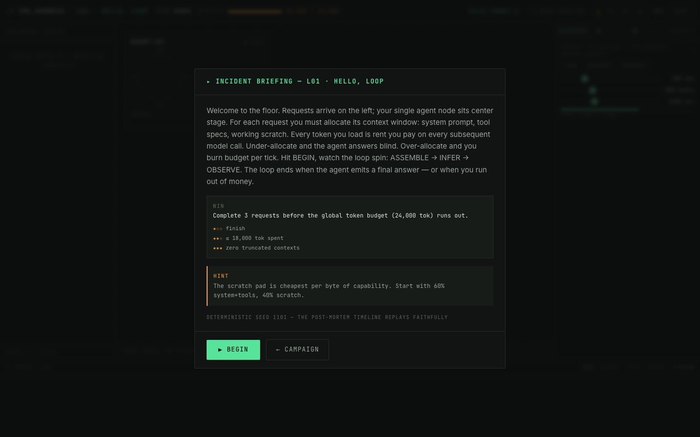
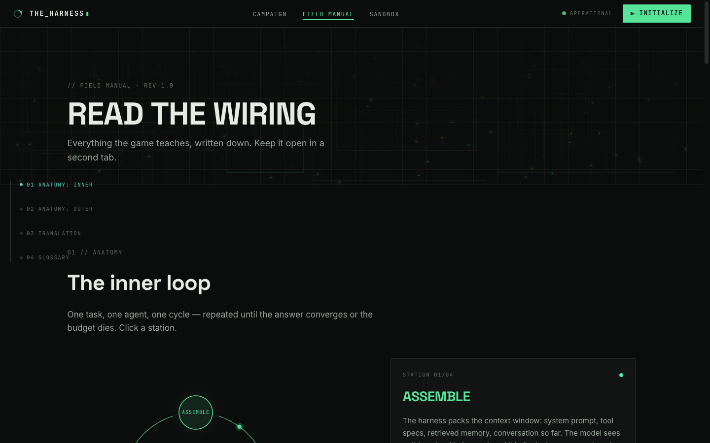
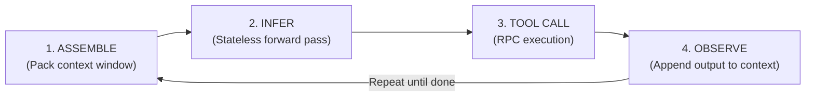
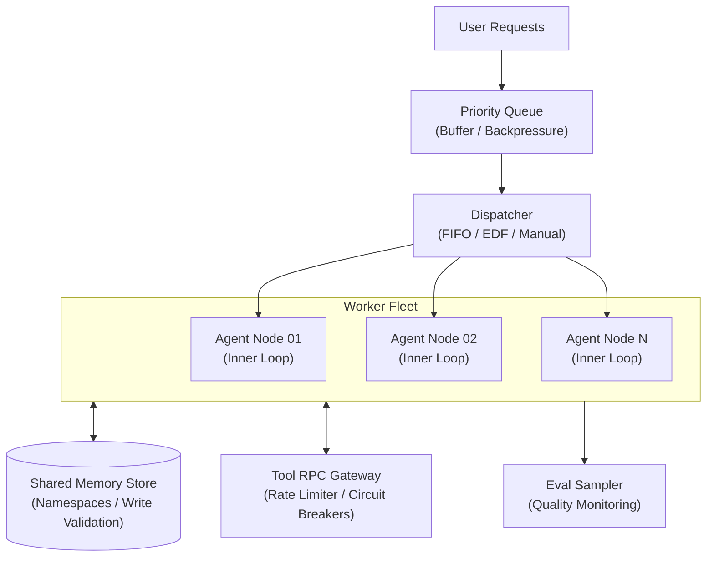

# THE_HARNESS

> **An Operations Game About LLM Harness Architecture**  
> *"The model is a stateless compute node. You are the control plane."*  
>  
> *Created by Kimi K3 Agent Swarm*



[](https://www.typescriptlang.org/)
[](https://react.dev/)
[](https://vitejs.dev/)
[](LICENSE)

---

## Overview

**THE_HARNESS** is an open-source, interactive simulation and educational game that teaches how modern Large Language Model (LLM) agent harnesses work under the hood.

Most discussions around LLMs focus on prompt engineering or model parameters. In production, however, **almost all agent failures are distributed systems failures**:
- Context windows saturating and paying compounding token rent on every inference call.
- Tool RPCs timing out, throwing 429s, or repeating non-idempotent credit card charges across retries.
- Parallel subagent workers diverging into split-brain states when assigned the same task.
- Shared memory stores getting contaminated by prompt injections that subsequent workers naively trust.

**THE_HARNESS** puts you in the operator's seat of an AI cluster control plane. Through six progressive incident scenarios and a real-time chaos engineering sandbox, you manage token budgets, configure dispatchers, tune circuit breakers, enforce idempotency, and contain security breaches.

---

## Screenshots & Interface Tour

### 1. Operations Floor & Chaos Engineering Sandbox
Simulate production workloads, trigger chaos drills (retry storms, queue starvation, flaky providers), monitor live telemetry, and tune real-time policies:



### 2. The 3D Datacenter Cluster & Live Ticker
Live visualization of the cluster floor, agent worker node topology, and real-time telemetry HUD:



### 3. Campaign Progression: Six Incidents
Step through six escalating operational crises, mastering context limits, RPC retries, log compaction, worker fan-out, 429 thundering herds, and prompt injection defense:



### 4. Incident Briefings & Mitigations
Detailed incident specs, win conditions, star challenges, and architectural hints for each crisis:



### 5. Interactive Field Manual & Systems Wiring
Explore interactive diagrams of the single-node Inner Loop and cluster Outer Loop, complete with failure mode signatures and real-world mitigations:



---

## The Central Analogy: Datacenter ↔ LLM Harness

The foundational philosophy of THE_HARNESS is:

```
┌─────────────────────────────────────────────────────────────┐
│                    THE DISTRIBUTED ANALOGY                  │
│                                                             │
│   The Model  ──────►  Stateless Compute Worker (CPU/GPU)    │
│   The Harness ─────►  Cluster Orchestrator / Control Plane   │
└─────────────────────────────────────────────────────────────┘
```

The model has **no persistent memory of prior invocations**. When an agent appears to "remember" something, the harness simply serialized that text back into the context window and sent it over the wire again. Every token loaded into context is **bandwidth and memory rent** paid on every single forward pass.

### The Rosetta Stone

| LLM Harness Concept | Distributed Systems Concept | Why It Matters |
| :--- | :--- | :--- |
| **Context Window** | **Node Memory (RAM)** | Fixed capacity; everything needed for inference must fit within it. |
| **Token Budget** | **Bandwidth & Billing Quota** | You are re-billed for the entire window on every forward pass. |
| **Tool Call** | **Remote Procedure Call (RPC)** | Carries latency, network jitter, transient errors, and timeouts. |
| **Subagent** | **Worker Node (Fan-Out)** | Concurrency increases throughput but incurs spawn overhead and burn rate. |
| **Shared Memory** | **External Key-Value Store** | Crossing a trust boundary; requires validation, eviction, and namespacing. |
| **Dispatcher** | **Task Scheduler** | FIFO vs. Earliest-Deadline-First (EDF) prevents queue starvation. |
| **Rate Limit (429)** | **Provider Backpressure** | Exceeding throughput triggers lockouts; retries cause thundering herds. |
| **Compaction** | **Log Compaction / GC** | Summarizing history reclaims window space at the expense of fidelity. |
| **Eval Sampling** | **Canary Analysis / Telemetry** | Statistical monitoring that tells you *that* you're wrong, not *where*. |
| **The Harness** | **The Control Plane** | The orchestrator coordinating compute, memory, I/O, and recovery. |

---

## Architectural Mechanics

The simulation models two interconnected feedback loops:

### 1. The Inner Loop (The Single-Node Cycle)

Each agent node executes a continuous loop until task convergence or budget exhaustion:



- **ASSEMBLE**: Packs system instructions, tool schemas, retrieved memory, and conversation history. Under-allocation yields hallucinations; over-allocation burns the token budget.
- **INFER**: A single forward pass. Pure compute: inputs in, logits/tool calls out.
- **TOOL CALL**: Dispatches structured requests to external services. Can fail, time out, or produce irreversible external side effects.
- **OBSERVE**: Appends tool results to the context log. As observations accumulate, the context approaches saturation and requires compaction or eviction.

---

### 2. The Outer Loop (The Cluster Control Plane)

The harness manages fleets of agents, incoming traffic, shared state, and external service guarantees:



- **Dispatcher & Queue**: Decouples bursty arrival rates from worker capacity. Implements ownership ledgers to avoid split-brain execution.
- **Tool RPC Gateway**: Enforces rate limiting, jittered exponential backoff, circuit breaking, and idempotency keys on side-effecting operations (e.g. `charge_card`).
- **Memory Store**: Provides persistent multi-agent memory while enforcing tenant isolation and write-schema validation to block prompt injection.
- **Eval Harness**: Samples outputs to detect quality degradation and semantic drift before answers reach users.

---

## The Campaign: 6 Progressive Incidents

The campaign guides players through six escalating operational crises:

| Level | Codename | Target Concepts | Player Control Levers |
| :---: | :--- | :--- | :--- |
| **01** | **HELLO, LOOP** | Context allocation, token burn, stateless compute | Allocation presets: Lean, Balanced, Paranoid |
| **02** | **TOOL TIME** | Tool RPC latency, transient errors, retry storms | Retry policies: None, Fixed, Exponential Backoff |
| **03** | **FULL CONTEXT** | Context overflow, lossy compaction, memory eviction | Compaction triggers, LRU eviction, memory wiring |
| **04** | **FAN-OUT** | Traffic bursts, worker spawning, split-brain hazards | Subagent worker pool, FIFO vs. EDF dispatching |
| **05** | **THE FLAKY RPC** | 429 lockouts, cascading failures, duplicate side-effects | Circuit breakers, idempotency keys, load shedding |
| **06** | **POISONED MEMORY** | Adversarial prompt injection, supply chain contamination | Write validation schemas, namespacing, eval samplers |

### Postmortems & System Failure Catalog

Every failure in the game is tied to an explicit systems postmortem:
- **`BUDGET_EXHAUSTED`** (*Rent-Seeking Context*): Underestimating the compounding cost of re-sending uncompacted history on every tick.
- **`RETRY_STORM`** (*Correlated Failure Amplification*): Aggressive fixed retries multiplying traffic when external dependencies are degraded.
- **`THUNDERING_HERD`** (*Synchronized 429 Cascades*): All agents waking simultaneously after a rate-limit cooldown and re-tripping the quota.
- **`SPLIT_BRAIN`** (*Double-Assignment*): Two agents processing the same request due to a race condition or missing ownership lease.
- **`POISONED_STATE`** (*Prompt Injection via Shared State*): Unsanitized tool observations poisoning persistent memory and corrupting subsequent agent queries.
- **`DOUBLE_SPEND`** (*Non-Idempotent Retries*): Retrying an unacknowledged side-effect tool without an idempotency key.

---

## Features

- **Deterministic Simulation Engine**: Tick-driven simulation (`src/game/engine.ts`) with seedable pseudo-random number generation (`prng.ts`) for reproducible scenarios.
- **Interactive Control Plane**: Real-time dials for context budgeting, agent concurrency, tool authorizations, and scheduler routing.
- **Interactive Datacenter 3D/Canvas Visuals**: Live topological views of worker nodes, packet flows, and queue states.
- **Chaos Engineering Sandbox**: Free-form simulation mode allowing operators to configure arrival rates, tool failure probabilities, fault correlation, and memory poisoning.
- **Field Manual & Glossary**: Built-in interactive textbook with architectural schematics, failure definitions, and real-world system design mitigation guides.
- **Audio Feedback**: Procedural WebAudio sound generator signaling state transitions, tool RPCs, and incident alarms.

---

## Quick Start

### Prerequisites
- [Node.js](https://nodejs.org/) v20 or higher
- `npm` v10 or higher

### Installation & Local Run

```bash
# 1. Clone the repository
git clone https://github.com/<your-username>/the-harness.git
cd the-harness

# 2. Install dependencies
npm install

# 3. Start the local development server
npm run dev
```

Visit **`http://localhost:3000`** in your browser.

### Available Scripts

| Command | Action |
| :--- | :--- |
| `npm run dev` | Starts the Vite development server with HMR at `localhost:3000` |
| `npm run build` | Runs TypeScript compilation (`tsc -b`) and generates production bundles in `dist/` |
| `npm run preview` | Previews the production build locally |
| `npm run lint` | Runs ESLint over all TypeScript and React files |

---

## Repository Structure

```
.
├── docs/                     # Architectural plans and specifications
│   ├── plan.md               # Original game design blueprint
│   └── scaffold-info.md      # UI and library component manifest
├── public/                   # Static assets, hero images, and graphics
│   ├── hero-datacenter.png   # Cluster scene visualization
│   ├── og-cover.png          # OpenGraph social share card
│   └── manual-header.png     # Manual header illustration
├── src/
│   ├── components/           # UI components, HUD widgets, and shadcn primitives
│   ├── game/                 # Core deterministic simulation engine
│   │   ├── engine.ts         # Simulation loop, agent state machines, token ledger
│   │   ├── levels.config.ts  # Level specs, request generators, win conditions
│   │   ├── postmortems.ts    # Systems failure taxonomy & educational copy
│   │   ├── prng.ts           # Mulberry32 seedable random generator
│   │   ├── sound.ts          # WebAudio procedural synthesizer
│   │   └── types.ts          # Core domain models and state types
│   ├── lib/                  # LocalStorage persistence, progress tracking & palette
│   ├── pages/                # Game views:
│   │   ├── Home.tsx          # Landing page & interactive architecture strip
│   │   ├── Levels.tsx        # Campaign level selection & star tracking
│   │   ├── Play.tsx          # Primary operations control plane & game loop
│   │   ├── Sandbox.tsx       # Chaos engineering laboratory
│   │   └── Manual.tsx        # Field Manual, architecture diagrams & glossary
│   ├── App.tsx               # Top-level routing
│   └── main.tsx              # DOM mounting and entry point
├── package.json              # Dependencies and metadata
├── vite.config.ts            # Vite bundler configuration
├── tailwind.config.js        # Datacenter theme & palette tokens
└── tsconfig.json             # TypeScript project references
```

---

## Deployment

The application is bundled as a static single-page application (SPA) with relative asset paths (`base: './'`).

### Deploy to GitHub Pages
1. Build the production bundle:
   ```bash
   npm run build
   ```
2. Deploy the `dist/` directory to your `gh-pages` branch using the `gh-pages` utility or GitHub Actions.

### Deploy to Vercel / Netlify / Cloudflare Pages
- **Build command**: `npm run build`
- **Output directory**: `dist`
- **Node version**: `20.x` or higher

---

## Educational Use

This repository was created as an educational resource for:
- **Computer Science & Distributed Systems Courses**: Teaching how classic systems concepts (scheduling, idempotency, rate limits, RPC failure semantics) apply to modern GenAI architectures.
- **AI Engineering Workshops**: Demonstrating why prompt engineering is only a fraction of building robust production agents.
- **Systems Design Reading Groups**: Facilitating hands-on exercises around backpressure, circuit breakers, and state poisoning.

Feel free to use and adapt this project for classroom instruction, internal tech talks, and engineering onboarding.

---

## Contributing

Contributions are warmly welcomed! Please see [CONTRIBUTING.md](CONTRIBUTING.md) for instructions on proposing new levels, expanding the systems manual, or enhancing the simulation engine.

---

## Acknowledgements

Created by **Kimi K3 Agent Swarm**.

---

## License

This project is open-source under the [MIT License](LICENSE).
